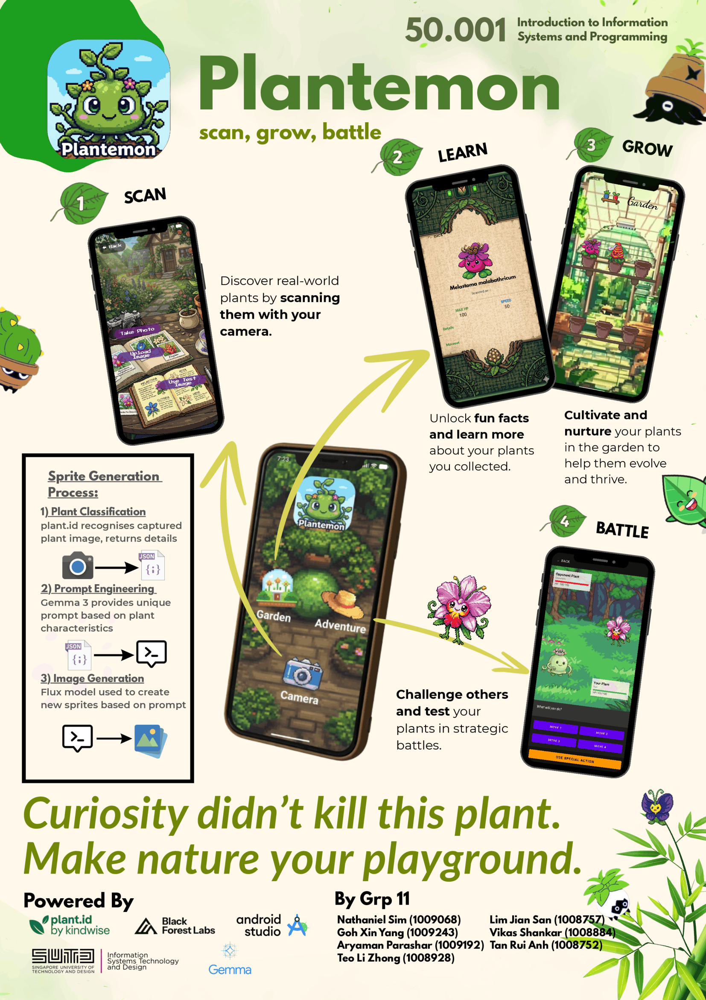
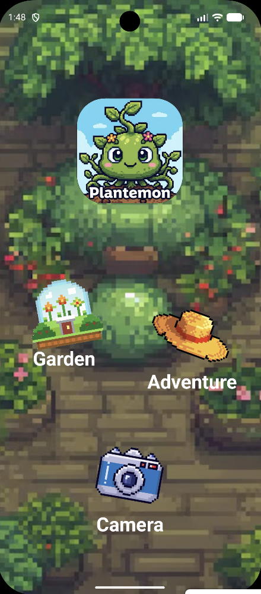
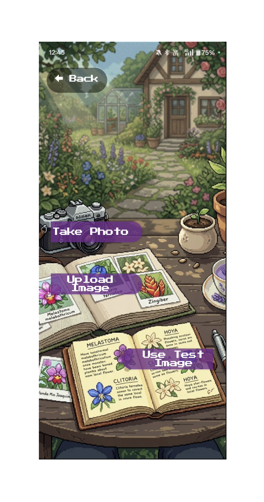
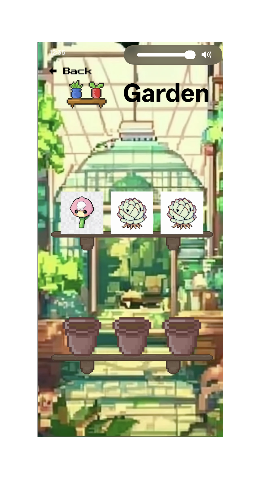
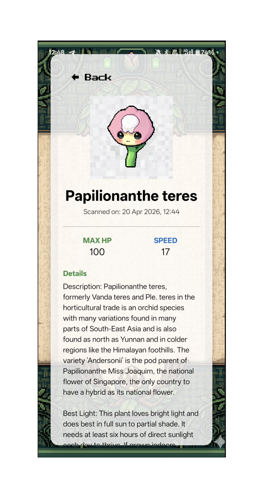
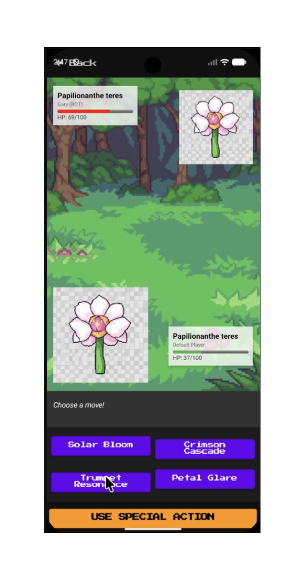

# Sprout Android (Plantemon)

Sprout's native Java Android game, originally named **Plantemon**. Scan real plants to create digital creatures that battle each other. Point your camera at any plant, and Plantemon identifies the species, generates a pixel-art sprite using AI, and adds it to your garden — where it can learn moves based on its real-world botanical taxonomy and fight other plants in turn-based battles.

[Features](#features) · [Screenshots](#screenshots) · [Setup](#getting-started) · [Architecture](#architecture) · [Build configuration](#build-configuration)

## Repository role and related projects

**Android implementation:** start in [`Plantemon/`](Plantemon/), the Java Android
project documented below. This repository's default branch is `infosys`; it is a
fork of [gxy812/katsu-an-g4ng](https://github.com/gxy812/katsu-an-g4ng) with local
development retained. The separate [`plantemon-app/`](plantemon-app/README.md)
Expo client and [`plantemon-server/`](plantemon-server/README.md) API are also
retained here with their own setup guides. They are independent ports; the
native Android setup below applies to `Plantemon/`. The source folder, Java
packages and app label retain the Plantemon name.

| Repository | Role |
|---|---|
| [sprout-android](https://github.com/Neonat/sprout-android) — this repository | Java Android game, plus the Expo client and API port above. |
| [sprout-web](https://github.com/Neonat/sprout-web) | Separate TypeScript web game: React, Express and Firestore. |
| [sprout-studio](https://github.com/Neonat/sprout-studio) | Private operations studio for sprite generation, evaluation and review; access required. |
| [sprout-web-prototype](https://github.com/Neonat/sprout-web-prototype) | Private early Next.js/v0 browser prototype; access required. |
| [sprout-android-placeholder](https://github.com/Neonat/sprout-android-placeholder) | Private empty placeholder; the Android implementation is in `Plantemon/` here. |


---

## Features

- **Scan real plants** — take a photo or upload an image; the app identifies the species and pulls botanical metadata (common names, description, light/soil/watering needs, toxicity, cultural significance)
- **AI sprite generation** — an LLM describes the plant as a Pokémon-style pixel-art sprite, which a generative image model renders into a 192×192 sprite unique to each plant
- **Taxonomy-based moveset** — moves are assigned from a decision tree based on the plant's real taxonomic class (mosses, ferns, conifers, and angiosperms each draw from a different move pool)
- **Garden collection** — up to 6 plants displayed on shelves; tap any pot to view full botanical info and stats
- **Turn-based battles** — fight a bot opponent using your scanned plants; speed determines turn order, moves have accuracy and damage mechanics, and each player gets 3 heals per match
- **Offline fallback** — if the Plant ID API is unreachable, a name dialog lets you add plants manually using the photo as the sprite

---

## Screenshots







---

## Getting Started

### Requirements

- Android Studio and a Gradle JDK compatible with the checked-in Android Gradle Plugin `9.1.0` and Gradle wrapper `9.4.0`
- Android SDK matching `compileSdk = 36` and `compileSdkMinor = 1`
- A physical device or emulator running Android 10+
- API keys for Plant.id and NVIDIA (see below)

### API Keys

Create `Plantemon/local.properties` beside the Android project's
`gradle.properties`, and add your provider keys:

```
PLANT_API_KEY=your_plant_id_key_here
NVIDIA_API_KEY=your_nvidia_key_here
FLUX_API_KEY=your_nvidia_key_here
```

- **Plant.id** — sign up at [plant.id](https://plant.id) for an API key
- **NVIDIA** — sign up at [build.nvidia.com](https://build.nvidia.com) for an API key; the same key is used for both the NIM (Gemma-3) and Flux image generation endpoints

> `local.properties` is git-ignored. Never commit API keys.

### Build & Run

```bash
git clone --branch infosys https://github.com/Neonat/sprout-android.git
cd sprout-android/Plantemon
```

1. Open this `Plantemon/` directory in Android Studio.
2. Configure the Android SDK and Gradle JDK, then add `local.properties` as above.
3. Sync Gradle and run the `app` module on an Android 10+ device or emulator.

The checked-in [Android CI workflow](.github/workflows/android.yml) targets
`infosys`. Builds, device behaviour and live provider calls have not been
revalidated for this README update. `SwitchAction` is retained as an
inactive placeholder in the battle implementation.

---

## Project Structure

The native application source is under [`Plantemon/app/`](Plantemon/app/).
The separate [`plantemon-app/`](plantemon-app/README.md) and
[`plantemon-server/`](plantemon-server/README.md) trees have their own dependency
and environment setup.

```text
Plantemon/app/src/main/java/com/g4ng/
├── ui/
│   ├── Plantemon.java              Application class; initialises databases, loads saved garden on startup
│   ├── GameState.java              Singleton holding the live Player instance ("Bob") and garden list
│   ├── MainActivity.java           Home screen with navigation to Garden, Battle, and Camera
│   ├── ScanActivity.java           Full scan pipeline: camera → Plant ID → sprite generation → garden
│   ├── GardenActivity.java         6-pot shelf view; tapping a pot opens InfoActivity
│   ├── InfoActivity.java           Detailed plant card with scrollable info and acorn scrollbar
│   └── BattleActivity.java         Turn-based battle UI: sprites, HP bars, move buttons, battle log
│
├── model/
│   ├── Plant.java                  Core entity (Serializable): UUID, name, HP, speed, moves, sprite path, metadata
│   ├── Player.java                 Username, garden list, active plant pointer, heal charge counter
│   └── BattleState.java            Enum: P1_MOVE → P2_MOVE → PROCESSING → END
│
├── logic/
│   ├── Action.java                 Interface: execute() → String log line, getDefenseValue()
│   ├── Move.java                   Implements Action; has attack, defense, accuracy, power
│   ├── HealAction.java             Restores 20% maxHP + 10; consumes 1 heal charge; defense value 15
│   ├── SwitchAction.java           Placeholder (not yet active)
│   ├── BattleHandler.java          State machine driving the turn loop; speed-ordered execution
│   ├── BattleController.java       Interface for pluggable player/bot decision logic
│   ├── HumanController.java        Human-side controller (UI drives input; controller is a no-op)
│   ├── BotController.java          AI controller: random move 87.5% of the time, HealAction 12.5%
│   └── PlantFactory.java           Static factory creating Plants from API JSON or saved data
│
├── database/
│   ├── Base.java                   Abstract generic repository; reads a JSON array and calls insert() per item
│   ├── MoveBase.java               Singleton HashMap<id, Move> loaded from res/raw/moves.json
│   ├── TaxonomyMoveMapBase.java    Singleton HashMap<groupId, List<moveIds>>; classifies plants by taxonomy
│   ├── Taxonomy.java               POJO: class, genus, order, family, phylum extracted from Plant.id response
│   └── PlantJsonHandler.java       Serialises/deserialises the garden to getFilesDir()/TEMP.json
│
└── service/
    ├── PlantApiService.java         Calls Plant.id v3/identification; extracts name, taxonomy, and metadata
    ├── SpriteGeneratorService.java  Two-step pipeline: Gemma-3 → text description → Flux → Bitmap; sprite cache
    └── AiSpriteGenerator.java       Legacy single-step Flux caller (superseded by SpriteGeneratorService)
```

---

## Architecture

### Design Patterns

| Pattern | Where |
|---|---|
| **Singleton** | `GameState`, `MoveBase`, `TaxonomyMoveMapBase` |
| **Strategy** | `BattleController` / `HumanController` / `BotController` — swap AI vs player decision logic |
| **Factory** | `PlantFactory.createFromApi()`, `createFromScan()`, `createFromSaved()` |
| **State Machine** | `BattleHandler.advanceState()` cycles `BattleState` enum |
| **Template Method** | `Base<K,V>.read()` defines the load skeleton; subclasses implement `insert()` |
| **Callback** | `SpriteGeneratorService.SpriteCallback` (onSuccess / onError) for async sprite generation |
| **Copy Constructor** | `Plant(Plant other)` for deep-cloning opponent plants before battle |
| **Observer** | `ProcessLifecycleOwner` triggers `PlantJsonHandler.savePlants()` when the app is backgrounded |

---

## How a Plant Gets Created

```
Camera / gallery / test image
        │
        ▼
 PlantApiService.fetchPlantDetails()
 POST https://api.plant.id/v3/identification
        │
        ├─ success → name, taxonomy, metadata
        │                │
        │                ▼
        │   SpriteGeneratorService.generate()
        │      1. check sprite cache
        │      2. NVIDIA Gemma-3: photo + name → pixel-art description
        │      3. NVIDIA Flux: description → 192×192 PNG
        │         └─ on failure → crop/scale the real photo (192×192)
        │
        └─ failure → name dialog (user types the plant name)
                      └─ sprite = photo cropped to square, scaled 192×192
        │
        ▼
 PlantFactory.createFromApi()  (or buildFallbackPlant())
   • Plant(name, speed, spritePath)
   • copy metadata fields from API JSON
   • TaxonomyMoveMapBase.getMoves(taxonomy) → shuffle → pick 4 moves
   └─ fallback: Tackle / Vine Whip / Leaf Shield / Solar Blast
        │
        ▼
 GameState.getPlayer().getGarden().add(plant)
 PlantJsonHandler.savePlants()  →  TEMP.json on internal storage
```

---

## Taxonomy → Move Mapping

Plant.id returns a full Linnaean taxonomy. `TaxonomyMoveMapBase` maps it to one of four move pools:

| Group | Taxonomic Criteria | Move Pool ID |
|---|---|---|
| Mosses / non-vascular | `phylum ≠ Tracheophyta` | 0 |
| Ferns | `class` ∈ {Polypodiopsida, Lycopodiopsida, Equisetopsida} | 1 |
| Conifers | `class` ∈ {Pinopsida, Cycadopsida, Ginkgoopsida, Gnetopsida} | 2 |
| Flowering plants | everything else (angiosperms) | 3 |

Moves within each pool are shuffled and the first four are assigned to the plant.

---

## Battle System

### Turn Loop

```
P1_MOVE  →  BattleHandler.applyAction(player, move)
P2_MOVE  →  BotController selects action
PROCESSING
  • compare speed — faster plant acts first
  • firstAction.execute(attacker, defender, defenderAction)
      damage = max(1, attacker.attack − defender.defenseValue)
      accuracy check: Math.random() * 100 ≤ accuracy
  • check faint → stop if defender dead
  • secondAction.execute() if first attacker still alive
  • check faint
P1_MOVE  (next turn)  or  END
```

### HealAction

- Restores `floor(maxHP × 0.2) + 10` HP, capped at max HP
- Each player has **3 heals per battle**
- Provides a defense value of 15 (opponent's attacks deal 15 less damage the same turn)

### Battle End

When either plant reaches 0 HP, the app plays a slide-down/fade faint animation, then shows a dialog. Both plants' HP and heal counts are **not restored** until the next battle is set up — the UI reads live values during the results display, so restoring early would show wrong numbers.

---

## Data Persistence

Plants are persisted as JSON to internal storage (`getFilesDir()/TEMP.json`) via `PlantJsonHandler`. The garden is:
- **Loaded** in `Plantemon.onCreate()` at app startup
- **Saved** automatically when the app moves to the background (`ProcessLifecycleOwner` observer)

Sprites are stored as PNG files in `getExternalFilesDir("Sprites")`. Generated sprites are additionally cached to `getFilesDir()/sprite_cache/sprite_<name>.png` so the NVIDIA APIs are only called once per plant name.

---

## External APIs

| Service | Endpoint | Used For |
|---|---|---|
| **Plant.id v3** | `https://api.plant.id/v3/identification` | Species identification from photo; returns name, taxonomy, and 8 metadata fields |
| **NVIDIA NIM — Gemma-3-27b-it** | `https://integrate.api.nvidia.com/v1/chat/completions` | Multimodal LLM; generates a pixel-art sprite description from the plant photo and name |
| **NVIDIA Flux.2-klein-4b** | `https://ai.api.nvidia.com/v1/genai/black-forest-labs/flux.2-klein-4b` | Text-to-image; renders the description as a 192×192 sprite PNG |

All three calls are made on background threads. Failure of any step triggers a silent fallback rather than crashing the scan flow.

---

## Permissions

| Permission | Reason |
|---|---|
| `CAMERA` | Taking plant photos in ScanActivity |
| `INTERNET` | Plant.id and NVIDIA API calls |
| `ACCESS_COARSE_LOCATION` | Declared in manifest (not actively used) |

Camera permission is requested at runtime the first time the Scan button is tapped.

---

## Raw Data Files

Located in `Plantemon/app/src/main/res/raw/`:

**`moves.json`** — array of move definitions:
```json
[{ "id": 1, "name": "Vine Whip", "attack": 20, "defense": 0, "accuracy": 90, "power": 100 }, ...]
```

**`taxonomy.json`** — array of move group definitions:
```json
[{ "id": 0, "group": "moss", "moves": [5, 12, 3, 8, ...] }, ...]
```

---

## Dependencies

```kotlin
// UI / Architecture
androidx.appcompat:appcompat:1.7.1
androidx.constraintlayout:constraintlayout:2.2.1
com.google.android.material:material:1.13.0
androidx.activity:activity:1.13.0

// Lifecycle (for auto-save on background)
androidx.lifecycle:lifecycle-process:2.10.0
androidx.lifecycle:lifecycle-common-java8:2.11.0-alpha03

// Networking
com.squareup.okhttp3:okhttp:5.3.2

// JSON (built-in org.json, no extra dependency needed)
```

---

## Build Configuration

| Property | Value |
|---|---|
| `minSdk` | 29 (Android 10) |
| `targetSdk` | 35 (Android 15) |
| `compileSdk` | 36 |
| `applicationId` | `com.g4ng.plantemon` |
| AGP | 9.1.0 |

API keys are injected as `BuildConfig` fields at compile time from `local.properties`. The app will compile without the keys but API calls will fail with 401 errors at runtime.

## Context and licence

This repository retains its fork relationship with
[gxy812/katsu-an-g4ng](https://github.com/gxy812/katsu-an-g4ng) and its own local
development history. The upstream [MIT licence and copyright notice](LICENSE)
remain in place. Related Sprout repositories are separate implementations and
should be reviewed independently before copying changes between them.
